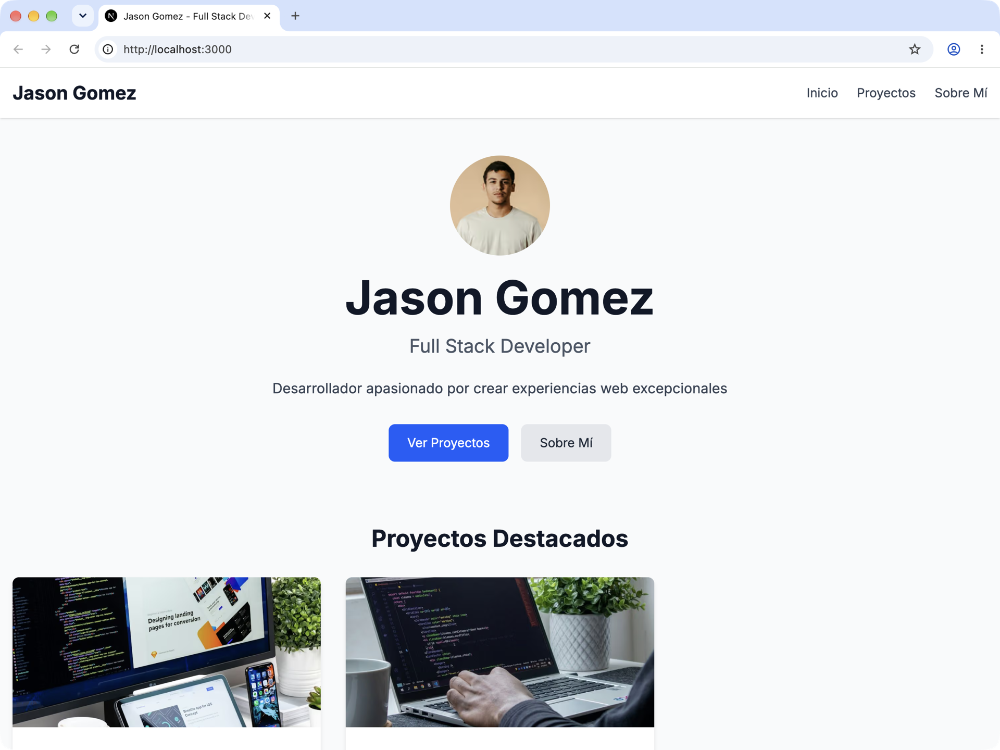
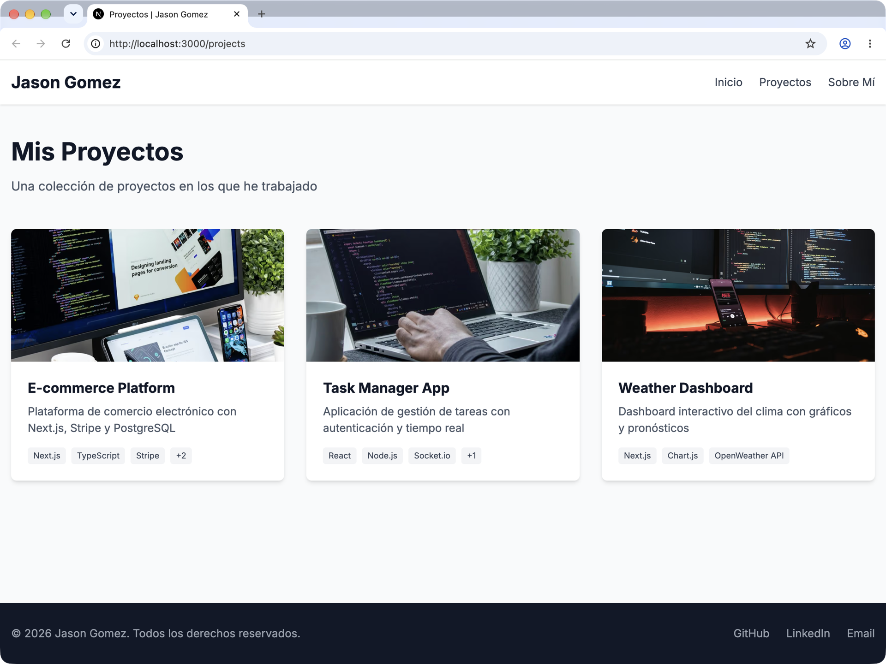
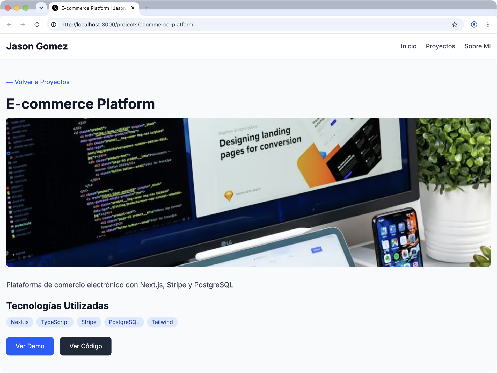
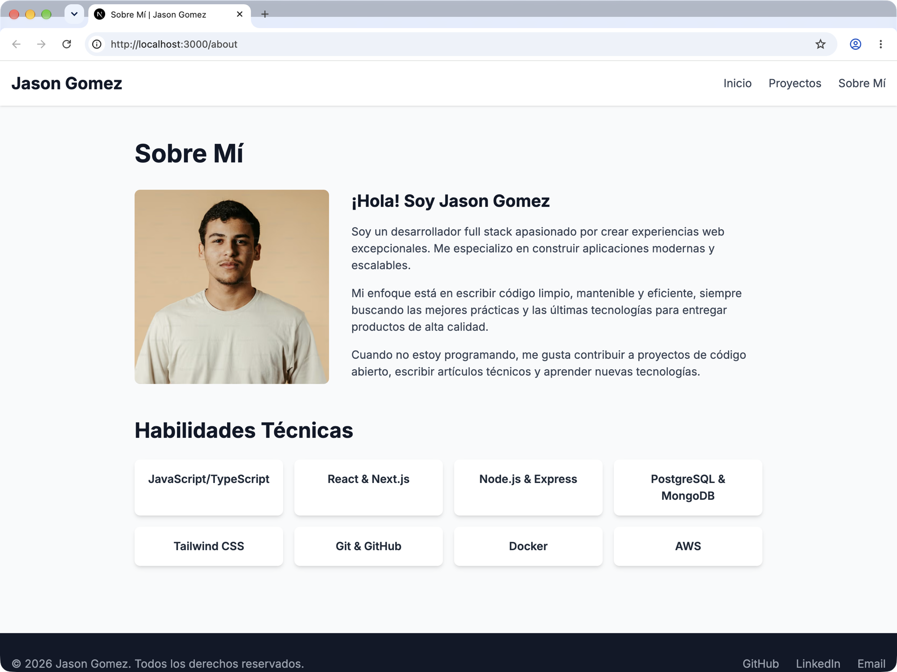
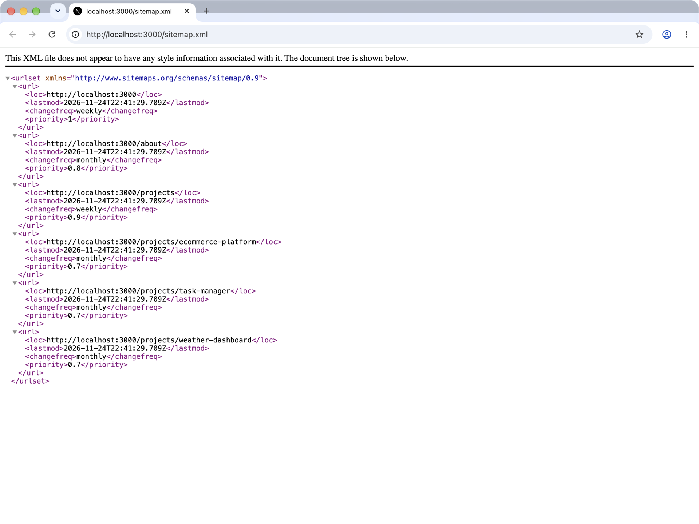
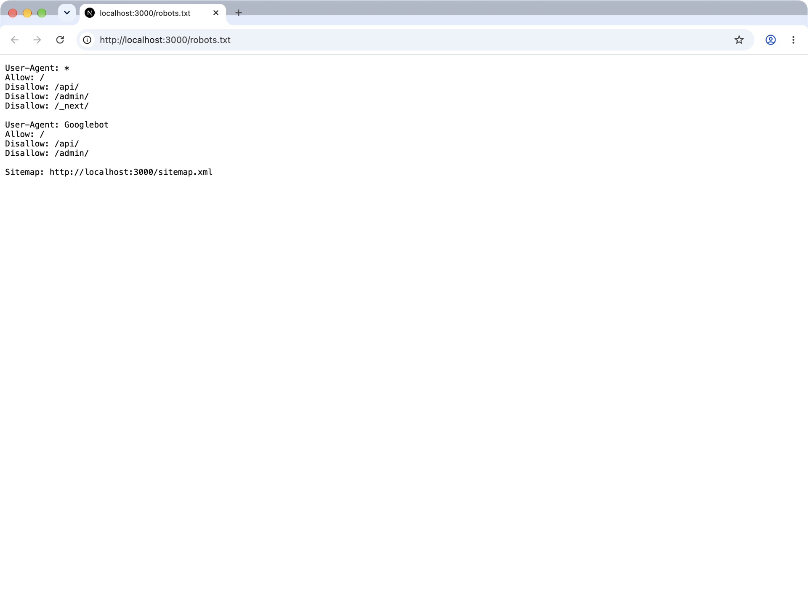
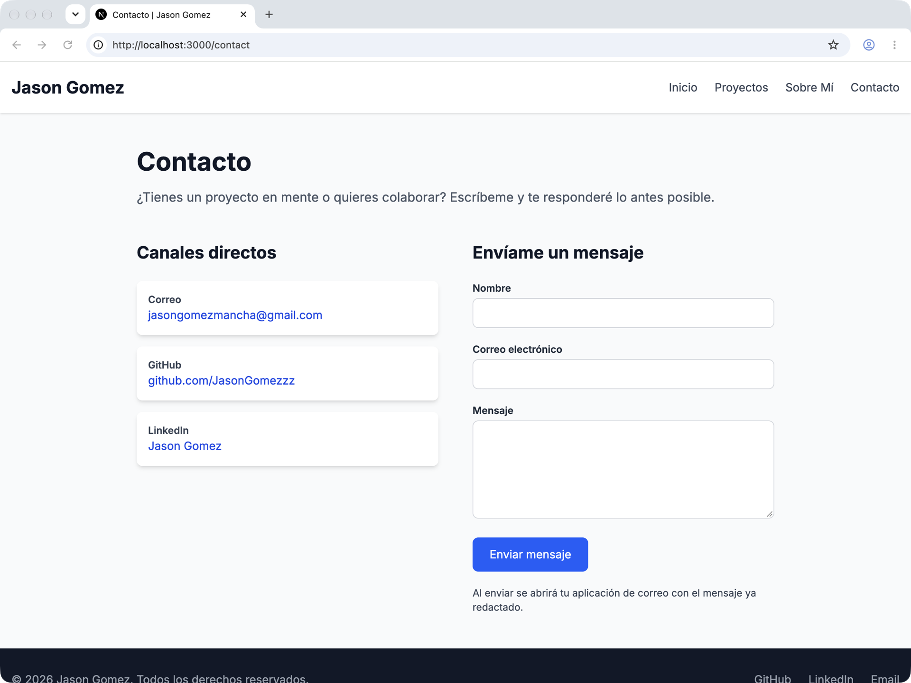
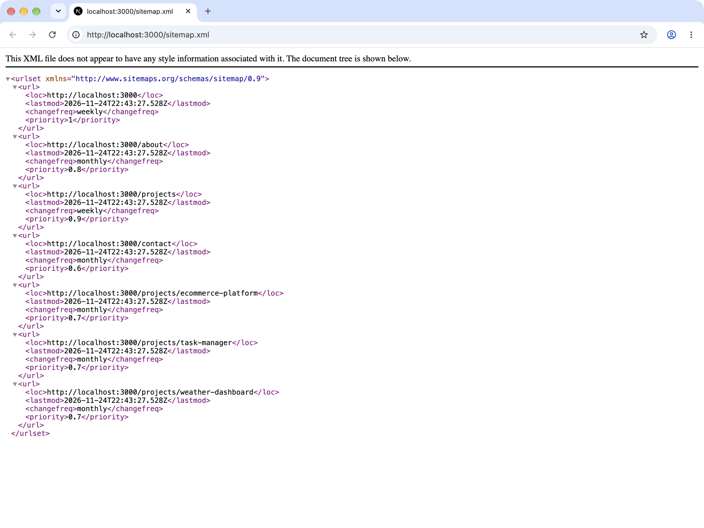
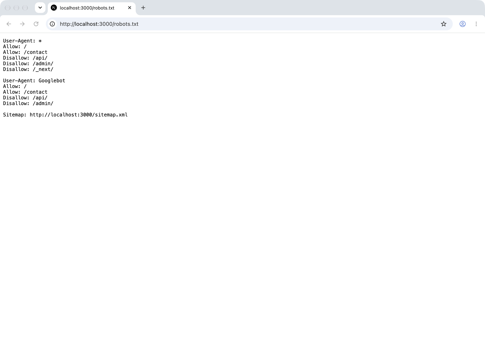

# Portafolio personal con SEO optimizado

Laboratorio S14 de **Desarrollo de Aplicaciones Web Avanzado** (TECSUP): portafolio
construido con Next.js (App Router) aplicando meta tags dinámicos, Open Graph,
`sitemap.xml` y `robots.txt` generados desde código, e imágenes optimizadas con
`next/image`. La tarea final agrega una página de contacto y deja el sitio listo para
desplegarse en Vercel con dominio propio.

## Requisitos

- Node.js 18.18 o superior (probado con Node 22) y npm.

## Instalación y ejecución

```bash
npm install
npm run dev          # desarrollo en http://localhost:3000
npm run build        # compilación de producción
npm start            # sirve la compilación de producción
npm run lint
```

## Variables de entorno

Se documentan en [`.env.example`](.env.example); copia el archivo a `.env.local` si
necesitas cambiarlas.

| Variable | Uso |
| --- | --- |
| `NEXT_PUBLIC_SITE_URL` | URL pública (con `https`, sin barra final). Alimenta `metadataBase`, Open Graph, `sitemap.xml` y `robots.txt`. Si falta, en Vercel se usa `VERCEL_PROJECT_PRODUCTION_URL` y en local `http://localhost:3000`. |
| `NEXT_PUBLIC_GOOGLE_SITE_VERIFICATION` | Código de Google Search Console (opcional). Sin valor no se emite la etiqueta. |

## Estructura

```
src/
├── app/
│   ├── layout.tsx              metadata global, fuente Inter, Header y Footer
│   ├── page.tsx                inicio
│   ├── about/page.tsx          sobre mí
│   ├── contact/page.tsx        contacto (tarea)
│   ├── projects/page.tsx       listado de proyectos
│   ├── projects/[slug]/page.tsx  detalle con metadata dinámica
│   ├── sitemap.ts              sitemap.xml dinámico
│   └── robots.ts               robots.txt
├── components/                 Header, Footer, ProjectCard, ContactForm
├── lib/data.ts                 proyectos e información personal
└── types/index.ts              interfaces Project y Metadata
public/                         og-image.jpg, og-projects.jpg
docs/capturas/                  evidencias del laboratorio
```

## Rutas

| Ruta | Descripción |
| --- | --- |
| `/` | Hero y proyectos destacados |
| `/projects` | Todos los proyectos |
| `/projects/[slug]` | Detalle; `generateStaticParams` + `generateMetadata` |
| `/about` | Perfil y habilidades |
| `/contact` | Canales directos y formulario |
| `/sitemap.xml` | Generado desde `app/sitemap.ts` |
| `/robots.txt` | Generado desde `app/robots.ts` |

## Cómo probar el SEO

```bash
npm run build && npm start
curl -s http://localhost:3000/ | grep -E '<title>|og:|twitter:|robots'
curl -s http://localhost:3000/projects/task-manager | grep -E '<title>|og:title|og:type'
curl -s http://localhost:3000/robots.txt
curl -s http://localhost:3000/sitemap.xml | grep '<loc>'
```

## Desviaciones respecto al enunciado

| # | Enunciado | Aplicado | Motivo |
| --- | --- | --- | --- |
| 1 | `next.config.ts` solo con `images` | Se conserva la config generada y se **desactivan** `cacheComponents` y `partialPrefetching` | Cache Components rechaza `new Date()` al prerenderizar y el build fallaba en el Footer con *"unstable value `new Date()`"*. |
| 2 | `siteUrl: 'https://tuportafolio.com'` | Se resuelve por entorno (ver variables) | Evita un dominio inventado y que sitemap, robots y Open Graph apunten a otro sitio. |
| 3 | `twitter.creator: '@tuusuario'` y `verification.google: 'tu-codigo-de-verificacion'` | Se omiten; la verificación solo se emite si hay variable | Eran valores de ejemplo que se habrían publicado como metadatos reales. |
| 4 | Referencia a `/og-image.jpg` y `/og-projects.jpg` sin entregarlas | Se generaron las dos imágenes (1200×630) en `public/` | Sin ellas las vistas previas de redes sociales devuelven 404. |
| 5 | Texto "más de X años de experiencia" | Se reemplazó por una redacción sin cifras | Era un marcador sin completar. |
| 6 | Header con `flex justify-between` | Header apilado en móvil y enlaces con mayor área táctil | A 375 px la navegación se desbordaba y el enlace "Contacto" quedaba cortado. |
| 7 | Clase `font-display` en el Header | Eliminada | No existe en Tailwind ni se define en el proyecto; no tenía efecto. |
| 8 | Freenom como fuente de dominio gratuito | Ver "Despliegue y dominio" | Freenom ya no regala dominios; volvió como registrador de pago. |
| 9 | Proyectos de ejemplo con URLs ficticias | Se mantienen | Son datos de demostración del enunciado (`demo.example.com`, `github.com/usuario/...`). Reemplázalos por proyectos reales. |

Además, el formulario de contacto **no envía correos desde el servidor**: arma un enlace
`mailto:` y abre el cliente de correo del visitante, porque el sitio es estático y no
tiene backend.

## Capturas

### Aplicación en local

| Página | Captura |
| --- | --- |
| `http://localhost:3000` |  |
| `http://localhost:3000/projects` |  |
| `http://localhost:3000/projects/ecommerce-platform` |  |
| `http://localhost:3000/about` |  |
| `http://localhost:3000/sitemap.xml` |  |
| `http://localhost:3000/robots.txt` |  |

### Tarea: contacto y archivos actualizados

| Página | Captura |
| --- | --- |
| `http://localhost:3000/contact` |  |
| `http://localhost:3000/sitemap.xml` (con `/contact`) |  |
| `http://localhost:3000/robots.txt` (con `/contact`) |  |

Las capturas se tomaron con `npm run dev` en una ventana de Chrome con perfil limpio y
la URL completa visible.

## Auditoría de rendimiento y SEO

Medición previa con Lighthouse 12 (línea de comandos, Chrome sin interfaz) sobre la
compilación de producción local. La auditoría del laboratorio debe repetirse desde
DevTools.

| Página | Modo | Performance | Accessibility | Best Practices | SEO |
| --- | --- | --- | --- | --- | --- |
| `/` | Desktop | 100 | 100 | 100 | 100 |
| `/` | Mobile | 96 | 100 | 100 | 100 |
| `/projects` | Mobile | 98 | 98 | 100 | 100 |
| `/projects/ecommerce-platform` | Mobile | 98 | 100 | 100 | 100 |
| `/about` | Mobile | 98 | 100 | 100 | 100 |
| `/contact` | Mobile | 98 | 100 | 100 | 100 |

## Despliegue y dominio

1. Subir el repositorio a GitHub.
2. En [Vercel](https://vercel.com/new) importar el repositorio (se detecta Next.js) y desplegar.
3. Dominio gratuito: Vercel entrega un subdominio `*.vercel.app` sin costo. Para un
   nombre propio gratuito existen subdominios como los de
   [is-a.dev](https://github.com/is-a-dev/register) (solicitud por *pull request*).
   Se asocia desde *Settings → Domains*, según la
   [documentación de Vercel](https://vercel.com/docs/domains/working-with-domains/add-a-domain).
4. En *Settings → Environment Variables* definir `NEXT_PUBLIC_SITE_URL` con el dominio
   final y volver a desplegar para que sitemap, robots y Open Graph lo usen.

- **Repositorio:** <https://github.com/JasonGomezzz/lab14-DAWA>
- **Dominio:** <https://lab14-dawa-ebon.vercel.app>

## Conclusiones (borrador)

1. **Cache Components choca con código habitual.** El build falló al prerenderizar
   porque el Footer del enunciado usa `new Date()`, algo que ese modo experimental de
   Next.js 16 prohíbe. Lo resolví leyendo el mensaje de error y
   desactivando la opción que traía el proyecto; la lección es revisar qué opciones
   genera `create-next-app` antes de copiar código de una guía escrita para otra versión.
2. **La Metadata API centraliza el SEO.** Definir `metadata` en el layout, sobrescribirla
   por página y calcularla con `generateMetadata` en el detalle evita editar el `<head>`
   a mano, y lo comprobé inspeccionando el HTML generado con `curl`. Su punto débil es que
   depende de la URL base: si `NEXT_PUBLIC_SITE_URL` no se configura en producción, las
   URLs de Open Graph y del sitemap apuntan a `localhost`.
3. **`next/image` mejora el rendimiento, pero `lazy` no siempre conviene.** Los formatos
   AVIF/WebP y el atributo `sizes` reducen el peso, y Lighthouse dio 96–100. Sin embargo,
   Next.js avisó en consola que la imagen de una tarjeta visible al cargar fue el LCP y
   debía llevar `loading="eager"`: aplicar lazy loading a todo es una regla simplista.
4. **Sitemap y robots como código evitan desfases, con matices.** Generarlos desde
   `lib/data.ts` hace que un proyecto nuevo aparezca solo en el sitemap. Críticamente,
   `lastModified: new Date()` cambia en cada compilación aunque el contenido no cambie,
   lo que no ayuda a los buscadores; convendría usar fechas reales por página.
5. **Probar en móvil destapó errores que el enunciado no prevé.** El Header se
   desbordaba a 375 px y el formulario de contacto no puede enviar correos sin backend,
   por lo que usa `mailto:`. Además Freenom, el recurso sugerido para el dominio gratuito,
   ya no ofrece ese servicio, así que hubo que buscar alternativas.
